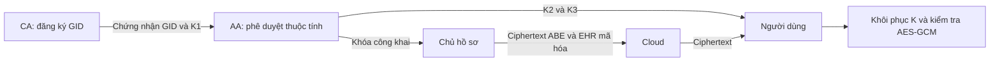

# SP-MAACS — Mô phỏng chia sẻ hồ sơ y tế bằng Java

Ứng dụng triển khai các bước của **SP-MAACS** trong bài **“Secured and Privacy-Preserving Multi-Authority Access Control System for Cloud-Based Healthcare Data Sharing”**, Gupta và cộng sự, *Sensors* 2023, 23, 2617, DOI [10.3390/s23052617](https://doi.org/10.3390/s23052617). Tài liệu chính trong thư mục là `3. Privacy preserving for healthcare data sharing.pdf`; các bước mật mã đối chiếu Mục 5, công thức (1)–(14), và cấu hình thực nghiệm đối chiếu Mục 6.3/Figure 3.

Phiên bản hiện tại: **2.0.2**, Java 21, giao diện Swing tiếng Việt, **JPBC 2.0.0 Type A1** và **BLS01/SHA-256**. Các phép lũy thừa và pairing thực hiện trên phần tử nhóm của JPBC. Cấu hình mặc định dùng ba số nguyên tố, **mỗi số 517 bit**.

README này hướng dẫn sử dụng phần mềm và giải thích **những gì mã nguồn hiện thực**. Đây là phần mềm thực nghiệm trên dữ liệu giả, với CA, AA, cloud và người dùng cùng nằm trong một tiến trình; chưa phải hệ thống bệnh viện triển khai qua mạng.

**Nội dung:**

- [1. Mục đích và các vai trò](#vai-tro)
- [2. Chuẩn bị, build và chạy](#cai-dat)
- [3. Thực hành với dữ liệu mẫu](#du-lieu-mau)
- [4. Tự tạo một kịch bản từ phiên trống](#tu-tao)
- [5. Cách viết chính sách truy cập](#chinh-sach)
- [6. Giải thích thuật toán từng bước](#thuat-toan)
- [7. Chạy và đọc benchmark](#benchmark)
- [8. Các lệnh CLI](#cli)
- [9. Kiểm tra kết quả và xử lý lỗi](#kiem-tra)
- [10. Phạm vi triển khai và tài liệu liên quan](#pham-vi)
- [11. Bản đồ mã nguồn](#ma-nguon)

<a id="vai-tro"></a>

## 1. Mục đích và các vai trò

Bài toán đặt ra: chủ hồ sơ muốn chia sẻ một EHR (Electronic Health Record — hồ sơ y tế điện tử) cho người có **đủ thuộc tính**, trong khi các thuộc tính được xác nhận bởi nhiều cơ quan khác nhau.

Cơ chế này thuộc CP-ABE (Ciphertext-Policy Attribute-Based Encryption): chính sách truy cập gắn với bản mã, còn khóa của người dùng gắn với các thuộc tính đã được cấp. Multi-authority nghĩa là nhiều AA cùng quản lý các miền thuộc tính riêng.

Ví dụ, một nhánh truy cập yêu cầu đồng thời:

- Là bác sĩ: `HOSPITAL.Profession=Doctor`.
- Thuộc bệnh viện AIIMS: `HOSPITAL.Affiliation=AIIMS`.
- Có chuyên khoa tim mạch: `MEDICAL.Specialization=Cardiology`.

HOSPITAL và MEDICAL là hai AA khác nhau. Người dùng phải có khóa do các AA tương ứng cấp cho **cùng một định danh GID**. Một người chỉ có khóa HOSPITAL và một người khác chỉ có khóa MEDICAL không được xem là một người có đủ quyền.

| Vai trò | Nhiệm vụ trong phần mềm |
|---|---|
| CA — Central Authority | Đăng ký GID, tạo thành phần khóa định danh và ký chứng nhận BLS |
| AA — Attribute Authority | Quản lý danh mục thuộc tính; xác minh chứng nhận CA rồi cấp khóa cho thuộc tính được phê duyệt |
| Chủ hồ sơ — Data Owner | Soạn EHR và chính sách; dùng khóa công khai của các AA để mã hóa |
| Cloud | Giữ ciphertext và phần công khai của chính sách |
| Người dùng — Data User | Dùng khóa định danh và khóa thuộc tính đã được cấp để giải mã |



Trong dữ liệu mẫu, HOSPITAL, MEDICAL, RESEARCH và INSURANCE đại diện miền mở; OWNER đại diện miền đóng, nơi chủ hồ sơ cấp thuộc tính quan hệ như Friend. Đây là cách bố trí vai trò trong mô phỏng; giao diện do một người vận hành toàn bộ các vai trò.

<a id="cai-dat"></a>

## 2. Chuẩn bị, build và chạy

### 2.1. Điều kiện

- **JDK 21 trở lên**, có đủ `java`, `javac` và `jar`.
- PowerShell; các lệnh dưới đây dùng `pwsh` của PowerShell 7.
- Maven nếu chọn cách build bằng Maven.
- Giữ thư mục `lib/` đi cùng dự án: trong đó có JPBC, Bouncy Castle và các thư viện cần thiết.

Mở PowerShell tại thư mục dự án:

```powershell
Set-Location D:/code/sp-maacs
java -version
```

Có hai cách build. Chọn một cách và chạy đúng JAR do cách đó tạo ra.

### 2.2. Cách A — Build trực tiếp bằng JDK

```powershell
pwsh -NoProfile -File ./build.ps1
./run.bat
```

Script tạo `build/sp-maacs-simulator.jar`. Có thể chạy trực tiếp:

```powershell
java '-Dfile.encoding=UTF-8' -jar build/sp-maacs-simulator.jar
```

`run.bat` luôn chạy JAR trong `build/`. Nó chỉ tự build khi JAR chưa tồn tại; **sau khi sửa mã nguồn, cần chạy lại `build.ps1`**.

### 2.3. Cách B — Build và kiểm tra bằng Maven

```powershell
pwsh -NoProfile -File ./tools/Run-Maven.ps1 -Goal verify -PaperTests
java '-Dfile.encoding=UTF-8' -jar target/sp-maacs-simulator-2.0.2.jar
```

Script tìm Maven trong PATH hoặc PATH đã đăng ký trên Windows, đăng ký thư viện có sẵn vào kho của dự án rồi gọi Maven. Lần đầu Maven có thể cần mạng để tải plugin hoặc thành phần kiểm thử.

- `verify`: biên dịch, chạy kiểm thử và đóng gói.
- `-PaperTests`: chạy thêm kiểm tra với ba số nguyên tố 517 bit.
- Báo cáo JUnit: `target/surefire-reports/`.
- Kho Maven cục bộ của dự án: `build/maven-repository/`.

Maven tạo JAR trong `target/`; **không cập nhật JAR trong `build/` mà `run.bat` sử dụng**. Khi vừa build bằng Maven, chạy lệnh `java -jar target/...` ở trên.

| Cách build | JAR được tạo | Cách mở tương ứng |
|---|---|---|
| `build.ps1` | `build/sp-maacs-simulator.jar` | `run.bat` hoặc `java -jar build/...` |
| Maven | `target/sp-maacs-simulator-2.0.2.jar` | `java -jar target/sp-maacs-simulator-2.0.2.jar` |

Giữ `lib/` cạnh `build/` hoặc `target/` khi sao chép ứng dụng. Nếu cửa sổ cũ đang mở, đóng rồi mở lại để nạp bản chương trình vừa build.

### 2.4. Trạng thái khi vừa mở giao diện

Ứng dụng mở ở cấu hình **517 bit**, nhưng **chưa tạo phiên mật mã**.

- **Nạp dữ liệu mẫu**: khởi tạo CA/AA, cấp khóa và mã hóa hồ sơ mẫu.
- **Phiên trống**: khởi tạo nhóm và CA để tự tạo cơ quan, người dùng, hồ sơ.
- **Xem cấu trúc DNF**, **Nạp CSV đã đo** và chuyển tab dùng được ngay.
- Các nút cấp khóa, mã hóa, giải mã được bật sau khi có phiên sẵn sàng.
- **Chạy benchmark** tự tạo môi trường đo riêng, không cần nạp dữ liệu mẫu.

Khởi tạo 517 bit có thể mất thời gian. Thanh trạng thái hiển thị tác vụ và số giây; xem thêm tab **Nhật ký thuật toán**. **Hủy tác vụ** yêu cầu dừng và chờ phép tính JPBC hiện tại kết thúc. Có thể cuộn nội dung tab nếu nút thao tác nằm ngoài vùng nhìn thấy.

Tham số đường cong được lưu tại `build/private/type-a1-3x517.properties`. File này chứa các thừa số bí mật của N; chỉ dùng làm cache cục bộ, không phải bản sao khóa người dùng hay cơ chế lưu phiên.

<a id="du-lieu-mau"></a>

## 3. Thực hành với dữ liệu mẫu

### Bước 1 — Nạp phiên mẫu

Nhấn **Nạp dữ liệu mẫu** và chờ thông báo sẵn sàng. Bộ đếm dưới cửa sổ phải có:

- 5 AA.
- 8 người dùng.
- 1 hồ sơ: `EHR-001`.

Phiên mẫu và benchmark là hai bộ dữ liệu khác nhau. Các danh mục trong phiên mẫu được chọn để minh họa vai trò; benchmark mới dùng cấu hình cố định 5 AA × 5 thuộc tính.

### Bước 2 — Đọc chính sách của hồ sơ mẫu

Hồ sơ dùng chính sách:

```text
(HOSPITAL.Profession=Doctor
 AND MEDICAL.Specialization=Cardiology
 AND HOSPITAL.Affiliation=AIIMS)
OR (RESEARCH.Role=Researcher AND RESEARCH.Project=HeartStudy)
OR OWNER.Relation=Friend
```

Có ba đường truy cập độc lập:

1. Bác sĩ, chuyên khoa tim mạch, thuộc AIIMS.
2. Nhà nghiên cứu thuộc dự án HeartStudy.
3. Người được OWNER cấp quan hệ Friend.

Người dùng chỉ cần thỏa **một nhánh OR**; trong nhánh đã chọn phải có **toàn bộ điều kiện AND**.

### Bước 3 — Chạy 8 tình huống

Mở **01 Tổng quan**, nhấn **Chạy 8 tình huống mẫu** và chờ hoàn tất.

| GID | Thuộc tính hoặc tình huống | Kết quả mong đợi |
|---|---|---|
| `doctor-an` | Doctor, Cardiology, AIIMS | Được phép |
| `doctor-binh` | Doctor, Neurology, AIIMS | Từ chối: sai chuyên khoa |
| `nurse-lan` | Nurse, Cardiology, AIIMS | Từ chối: sai nghề nghiệp |
| `researcher-minh` | Researcher, HeartStudy | Được phép |
| `friend-ha` | OWNER.Relation=Friend | Được phép |
| `outsider` | Đã đăng ký nhưng chưa có thuộc tính | Từ chối |
| `colluder-a` | Doctor và AIIMS, thiếu MEDICAL | Từ chối |
| `colluder-b` | Cardiology, thiếu HOSPITAL | Từ chối |

**8/8 PASS** có nghĩa là cả 8 quyết định phù hợp kỳ vọng, gồm 3 lần được phép và 5 lần từ chối.

### Bước 4 — Tự giải mã từng người

1. Mở **04 Truy cập & thông đồng**.
2. Chọn **Người dùng / GID**, chẳng hạn `doctor-an`.
3. Chọn **Hồ sơ cloud** là `EHR-001`.
4. Nhấn **Giải mã hồ sơ**.
5. Đổi sang `doctor-binh` rồi giải mã lại để quan sát việc từ chối dù có cùng tên thuộc tính.

Khi được phép, nội dung EHR giả xuất hiện cùng nhánh giải mã và số pairing. Khi đổi người dùng/hồ sơ hoặc gửi yêu cầu mới, plaintext của kết quả cũ được xóa.

### Bước 5 — Thử ghép khóa hai người

Trong cùng tab, giữ hồ sơ `EHR-001`:

1. Ở **Thử ghép khóa**, chọn A = `colluder-a`, B = `colluder-b`.
2. Nhấn **Ghép & thử cả hai K1**.
3. Kết quả mong đợi: hai người riêng lẻ đều bị từ chối; ghép khóa theo cả hai lựa chọn K1 cũng bị từ chối.

Tình huống này kiểm tra việc cộng các thuộc tính nhìn thấy trong danh sách chưa đủ để giải mã: khóa còn bị ràng buộc vào định danh mật mã của từng người.

### Bước 6 — Quan sát dữ liệu cloud

1. Mở **05 Cloud công khai**.
2. Chọn `EHR-001`.
3. Xem `publicPolicy`, các nhánh, W, C/C0/C1/C2 và payload đã mã hóa.
4. Nhấn **Xuất JSON công khai** nếu muốn lưu đối tượng đang xem.

Chính sách hiển thị ở cloud có dạng `HOSPITAL.Profession=*`. Tên thuộc tính và cấu trúc nhánh còn công khai; giá trị Doctor không được chép trực tiếp vào trường chính sách ciphertext. JSON hiện dùng để kiểm tra, **chưa có chức năng nhập lại hoặc khôi phục phiên**.

<a id="tu-tao"></a>

## 4. Tự tạo một kịch bản từ phiên trống

Ví dụ này dùng hai AA và một nhánh AND ba thuộc tính, đủ để thử cấp quyền và ghép khóa.

### Bước 1 — Tạo phiên

Nhấn **Phiên trống**, xác nhận thay phiên nếu đang có dữ liệu và chờ sẵn sàng. Việc thay phiên bỏ CA/AA, khóa và hồ sơ hiện có trong bộ nhớ.

### Bước 2 — Tạo AA HOSPITAL

Mở **02 Cơ quan & người dùng**. Trong **Thêm cơ quan thuộc tính**:

- **Mã AA**: `HOSPITAL`.
- Thay toàn bộ ô **Danh mục: mỗi dòng Name=Value** bằng:

```text
Profession=Doctor
Profession=Nurse
Affiliation=AIIMS
```

Nhấn **AASetup · Tạo cơ quan**, chờ hoàn tất.

Danh mục chỉ nhập `Name=Value`; chương trình tự thêm mã AA. Không nhập `HOSPITAL.Profession=Doctor` vào ô danh mục này.

### Bước 3 — Tạo AA MEDICAL

Thay **Mã AA** bằng `MEDICAL`, thay toàn bộ danh mục bằng:

```text
Specialization=Cardiology
Specialization=Neurology
```

Nhấn **AASetup · Tạo cơ quan**, chờ hoàn tất.

### Bước 4 — Đăng ký bốn GID tại CA

Trong **Đăng ký tại CA**, nhập từng GID rồi nhấn **Đăng ký**; chờ tác vụ xong trước khi đăng ký người tiếp theo:

```text
doctor-custom
outsider-custom
part-hospital
part-medical
```

Đăng ký mới chỉ tạo định danh và chứng nhận. Người dùng chưa được cấp thuộc tính sẽ chưa giải mã được chính sách đang xét.

### Bước 5 — Cấp khóa thuộc tính

Trong **AA phê duyệt & cấp khóa**, chọn đúng người dùng, giữ **Ctrl** để chọn nhiều thuộc tính rồi nhấn **Cấp các thuộc tính đã chọn**.

| GID | Các thuộc tính cần chọn |
|---|---|
| `doctor-custom` | `HOSPITAL.Profession=Doctor`, `HOSPITAL.Affiliation=AIIMS`, `MEDICAL.Specialization=Cardiology` |
| `part-hospital` | `HOSPITAL.Profession=Doctor`, `HOSPITAL.Affiliation=AIIMS` |
| `part-medical` | `MEDICAL.Specialization=Cardiology` |
| `outsider-custom` | Không cấp thuộc tính |

Chờ hoàn tất sau mỗi lần cấp. Danh sách được làm mới sau các thao tác quản lý; kiểm tra lại GID và chọn lại thuộc tính trước lần cấp tiếp theo. Có thể cấp thêm thuộc tính cho cùng GID; các thuộc tính đã cấp trước đó được giữ lại.

### Bước 6 — Soạn và mã hóa EHR

Mở **03 Mã hóa hồ sơ**:

- **Mã hồ sơ**: `EHR-CUSTOM-001`.
- **Nội dung EHR giả lập**: nhập một đoạn dữ liệu giả.
- **Thay toàn bộ chính sách mặc định** bằng:

```text
HOSPITAL.Profession=Doctor
AND HOSPITAL.Affiliation=AIIMS
AND MEDICAL.Specialization=Cardiology
```

Việc thay toàn bộ chính sách là cần thiết vì phiên này chỉ có HOSPITAL và MEDICAL, chưa có các AA RESEARCH/OWNER trong chính sách mẫu.

Nhấn **Xem cấu trúc DNF**: kết quả phải có **1 nhánh, 3 dòng LSSS**. Sau đó nhấn **Mã hóa & đưa lên cloud** và chờ hoàn tất.

### Bước 7 — Kiểm tra quyền và ghép khóa

Mở **04 Truy cập & thông đồng**, chọn hồ sơ `EHR-CUSTOM-001`:

- `doctor-custom`: giải mã thành công.
- `outsider-custom`: từ chối vì không có thuộc tính.
- `part-hospital`: từ chối vì thiếu MEDICAL.
- `part-medical`: từ chối vì thiếu HOSPITAL.
- Ghép `part-hospital` + `part-medical`: cả hai lựa chọn K1 đều bị từ chối.

Nút **Chạy 8 tình huống mẫu** dành riêng cho bộ GID và `EHR-001` của phiên mẫu. Với phiên tự tạo, kiểm tra bằng các lựa chọn giải mã như trên.

<a id="chinh-sach"></a>

## 5. Cách viết chính sách truy cập

Một thuộc tính đầy đủ có dạng:

```text
AA.Name=Value
```

Ví dụ:

```text
HOSPITAL.Profession=Doctor
OWNER.Relation="Close Friend"
```

| Thành phần | Quy tắc |
|---|---|
| AA | Mã cơ quan đã tạo, ví dụ HOSPITAL |
| Name | Tên thuộc tính trong danh mục AA, ví dụ Profession |
| Value | Giá trị do AA đã công bố, ví dụ Doctor |
| `AND` | Cần đồng thời các điều kiện; ưu tiên cao hơn OR |
| `OR` | Chỉ cần một nhánh được thỏa |
| Ngoặc | Chỉ định nhóm điều kiện |
| Chuỗi có khoảng trắng | Đặt trong dấu nháy, ví dụ `"Close Friend"` |

**AA, tên và giá trị phân biệt hoa/thường.** `Doctor` khác `doctor`. Riêng từ khóa `AND`/`OR` không phân biệt hoa/thường; parser cũng nhận `&`/`&&` và `|`/`||`.

Ví dụ chuyển đổi:

```text
A AND (B OR C)
    → (A AND B) OR (A AND C)
```

A/B/C ở đây là ký hiệu rút gọn cho ba biểu thức `AA.Name=Value`, không phải cú pháp thuộc tính có thể nhập nguyên dạng.

Chương trình biên dịch chính sách thành **DNF**: OR giữa các nhánh, AND trong mỗi nhánh. Nhánh trùng và nhánh bị hấp thụ được giản lược, chẳng hạn `A OR (A AND B)` còn `A`.

Giới hạn hiện tại:

- Tối đa 32 nhánh DNF, 64 dòng mỗi nhánh, 256 dòng tổng cộng.
- Tối đa 64 mức ngoặc và 16.000 ký tự chính sách.
- Chưa hỗ trợ NOT, ngưỡng k-of-n hoặc nhập ma trận LSSS tùy ý.
- Một người có nhiều khóa cùng tên có thể làm tăng số tổ hợp thử; giải mã EHR giới hạn 4096 tổ hợp cho toàn yêu cầu.

<a id="thuat-toan"></a>

## 6. Giải thích thuật toán từng bước

### 6.1. Ký hiệu và ý tưởng nền tảng

| Ký hiệu | Ý nghĩa |
|---|---|
| `N = p1 · p2 · p3` | Bậc nhóm hợp số; mặc định mỗi pi là số nguyên tố 517 bit |
| `G, GT` | Nhóm nguồn và nhóm đích của pairing |
| `Gp1, Gp3` | Các nhóm con bậc p1 và p3 trong G |
| `g` | Phần tử sinh dùng trong Gp1 |
| `e: G × G → GT` | Phép pairing song tuyến tính |
| `gid, r_gid` | Định danh người dùng và số ngẫu nhiên gắn với định danh đó |
| `αk, βk` | Bí mật riêng của AA thứ k |
| `ta, Ta = g^ta` | Bí mật và phần công khai cho thuộc tính đầy đủ a=(AA, tên, giá trị) |
| `K` | Khóa ngẫu nhiên ở dạng phần tử nhóm đích GT,p1, được ABE bọc lại |
| `s, v, λx` | Bí mật của một nhánh, vector chia sẻ và phần chia sẻ cho dòng x |
| `μx` | Hệ số dùng để tái tạo bí mật từ các dòng LSSS |
| `R_gid, R2,k, R3,a` | Các phần tử làm mù thuộc Gp3 |

Tính song tuyến tính cho phép chuyển các số mũ qua pairing:

```text
e(g^a, g^b) = e(g,g)^(a·b)
```

Hai nhóm con Gp1 và Gp3 trực giao:

```text
e(X, R) = 1, với X thuộc Gp1 và R thuộc Gp3
```

Nhờ đó, thành phần làm mù của khóa biến mất khi pairing với thành phần ciphertext thuộc Gp1. Phần ngẫu nhiên r_gid vẫn tham gia công thức, tạo ràng buộc giữa những khóa cấp cho cùng một người.

### 6.2. GlobalSetup — Khởi tạo hệ thống

`CompositeGroup` dùng `TypeA1CurveGenerator(3, 517)` để tạo hoặc đọc tham số đường cong. Constructor kiểm tra ba số nguyên tố phân biệt, kích thước từng số và tích N, rồi tạo generator các nhóm con và phần tử `e(g,g)`.

Phân biệt:

- **Công khai**: các phần tử và tham số cần cho phép toán công khai, gồm N.
- **Riêng tại máy mô phỏng**: phân tích N thành p1/p2/p3 trong cache `build/private/`.

517 bit là kích thước **mỗi số nguyên tố**, không phải kích thước của N và cũng không phải tên mức an toàn tính bằng bit. Tham số 64 bit trong kiểm thử chỉ để chạy nhanh.

### 6.3. CASetup và AASetup — Tạo cơ quan

**CASetup:** CA tạo cặp khóa chữ ký BLS01/SHA-256. Khóa xác minh của CA được cấu hình cho các AA.

**AASetup:** AA thứ k chọn các số bí mật αk, βk; với mỗi thuộc tính a trong danh mục, chọn ta. Các thành phần tương ứng với (1)–(4) được viết lại như sau:

```text
PKk,1 = e(g,g)^αk
PKk,2 = g^βk
Ta    = g^ta

APKk = {PKk,1, PKk,2, các Ta trong danh mục}
ASKk = {αk, βk, các ta tương ứng}
```

APK là khóa công khai, ASK là dữ liệu bí mật của AA. Ta gắn với **cả tên và giá trị**, nên Profession=Doctor và Profession=Nurse có các phần tử riêng.

Chủ hồ sơ chỉ cần APK để mã hóa; không cần nhận αk, βk hoặc ta.

### 6.4. CAKeyGen — Đăng ký và ràng buộc GID

Khi đăng ký một GID chưa tồn tại, CA chọn r_gid và phần tử làm mù R_gid:

```text
K1 = g^r_gid · R_gid                                      (9)
```

CA ký thông điệp nhị phân chứa miền định danh của giao thức, GID và mã hóa JPBC của K1. Người dùng nhận GID, K1 và chữ ký làm chứng nhận.

Chữ ký BLS cho AA biết rằng **GID và K1 này được CA xác nhận, không bị thay đổi**. Nó không tự chứng minh người dùng là bác sĩ; bước phê duyệt thuộc tính vẫn thuộc trách nhiệm AA.

Mỗi GID chỉ được đăng ký một lần trong phiên. GID chấp nhận chữ, số, `_`, `@`, `.`, `-`, tối đa 80 ký tự.

### 6.5. AAKeyGen — Cấp khóa thuộc tính

AA thực hiện lần lượt:

1. Xác minh chữ ký chứng nhận bằng khóa CA đã được cấu hình.
2. Kiểm tra thuộc tính yêu cầu có trong danh mục của chính AA.
3. Cấp khóa cho các thuộc tính mà người vận hành phê duyệt.

Các thành phần chính:

```text
K2,k = g^αk · K1^βk · R2,k                              (10)
K3,a = K1^ta · R3,a                                    (11)
```

Một bộ khóa người dùng gồm:

- K1 dùng chung cho định danh đó.
- Một K2,k cho mỗi AA đã cấp khóa.
- Các K3,a ứng với thuộc tính AA đã cấp.

Khi cấp thêm thuộc tính, chương trình giữ các K3 cũ, thêm/thay K3 được cấp và cập nhật K2 của AA. Với cùng AA và GID, phần thuộc Gp1 của K2 vẫn tương ứng cùng αk, βk và K1; phần làm mù mới không làm mất hiệu lực các thuộc tính cũ. Thao tác này **không phải thu hồi khóa**.

### 6.6. Chia sẻ bí mật bằng DNF và LSSS

Mỗi nhánh AND được xử lý độc lập. Với nhánh có n dòng, tạo vector:

```text
v = (s, v2, ..., vn)^T
λx = Wx · v mod N
```

Ví dụ nhánh AND ba dòng:

```text
W = [1  1  0]       v = [ s ]
    [0 -1  1]           [v2 ]
    [0  0 -1]           [v3 ]

λ1 = s + v2
λ2 = -v2 + v3
λ3 = -v3
λ1 + λ2 + λ3 = s                 (tính trong Z_N)
```

W là ma trận chia sẻ bí mật; dòng x gắn với tên thuộc tính tương ứng. Để lấy lại s cần hệ số μ sao cho:

```text
Σx μx · Wx = (1, 0, ..., 0)
⇒ Σx μx · λx = s
```

Với ma trận AND do chương trình sinh, các μx đều bằng 1. Mã giải mã vẫn gọi `Lsss.reconstruct` để tính và xác minh hệ số tái tạo, thay vì gán cứng chúng.

Solver dùng khử Gauss modulo N với pivot khả nghịch. Nó đáp ứng ma trận được sinh trong ứng dụng, nhưng chưa là bộ giải đầy đủ cho mọi hệ tuyến tính trên vành hợp số Z_N.

### 6.7. Encrypt — Bọc khóa bằng chính sách

Chương trình chọn K thuộc GT,p1. Với **mỗi nhánh DNF**, nó chọn s, các tọa độ v còn lại và rx ngẫu nhiên mới.

Gọi SAA là tập các AA khác nhau xuất hiện trong nhánh. Tính:

```text
C    = K · (∏k∈SAA PKk,1)^s                             (5)
C0   = g^s                                             (6)
C1,x = (∏k∈SAA PKk,2)^λx · Ta^(-rx)                    (7)
C2,x = g^rx                                            (8)
```

Ở dòng x, a là **thuộc tính đầy đủ được yêu cầu tại dòng đó**, và Ta được lấy từ danh mục công khai của AA quản lý nó.

Một AA chỉ xuất hiện **một lần trong các tích theo k**, kể cả khi AA đó quản lý nhiều dòng trong nhánh. Tất cả nhánh bọc **cùng một K**, nên giải được bất kỳ nhánh nào cũng thu hồi được khóa cho cùng hồ sơ.

Ciphertext ABE giữ C, C0, C1,x, C2,x, W, tên AA và tên thuộc tính. Giá trị chính sách không được lưu trực tiếp trong mỗi `Row`.

Với b nhánh và tổng l dòng, số phần tử nhóm ABE là `2b + 2l`; cấu trúc càng nhiều nhánh/dòng thì ciphertext và lượng tính toán càng tăng.

### 6.8. Mã hóa nội dung EHR bằng HKDF và AES-GCM

K là phần tử nhóm, **chưa phải khóa AES 32 byte**. Lớp mã hóa EHR của chương trình thực hiện:

1. Mã hóa K thành byte bằng JPBC.
2. Sinh salt ngẫu nhiên 32 byte.
3. Dùng HKDF-SHA256 để dẫn xuất khóa AES dài 32 byte.
4. Sinh IV 12 byte và mã hóa EHR bằng AES-256-GCM, tag 128 bit.
5. Gắn header công khai làm AAD để việc sửa header làm kiểm tra GCM thất bại.

Cách dẫn xuất khóa đang dùng:

```text
PRK    = HMAC-SHA256(salt, K.bytes())
info   = UTF8("SP-MAACS-SIM/AES-256-GCM/v1")
aesKey = HMAC-SHA256(PRK, info || 0x01)
```

AAD là **header nhị phân có thứ tự và phân tách độ dài xác định**, gồm định danh giao thức/backend, mã hồ sơ, N, salt, IV, danh sách AA và các thành phần của mọi nhánh: tên, W, C/C0/C1/C2. Đây không phải nguyên chuỗi JSON đang hiển thị.

HKDF, lựa chọn AES-GCM và định dạng AAD là chi tiết bổ sung của phần mềm cho bước mã hóa đối xứng trong bài. Chúng được tách khỏi thời gian ABE trong benchmark.

### 6.9. Decrypt — Khôi phục K và giải mã EHR

Với một nhánh đủ tên thuộc tính và các khóa ứng viên:

```text
CK          = ∏k∈SAA K2,k

numerator   = e(CK, C0)                                (12)
denominator = ∏x [e(C1,x, K1) · e(C2,x, K3,x)]^μx       (13)

K' = C / (numerator / denominator)                     (14)
```

**Vì sao khóa đúng khôi phục được K?**

Đặt E=e(g,g), A=Σk αk, B=Σk βk và r=r_gid. Khi khóa K3 đúng giá trị và cùng định danh với K1, các số hạng chứa ta và rx triệt tiêu:

```text
e(C1,x, K1) · e(C2,x, K3,x) = E^(r · B · λx)

denominator = E^(r · B · Σx μxλx)
            = E^(r · B · s)

numerator   = E^(A·s + r·B·s)

numerator / denominator = E^(A·s)
K' = [K · E^(A·s)] / E^(A·s) = K
```

Các thành phần làm mù Gp3 biến mất nhờ tính trực giao. Nếu chọn sai giá trị hoặc ghép khóa có r_gid khác nhau, các số hạng nói trên có thể không triệt tiêu, dẫn tới K' sai.

Luồng giải mã EHR trong giao diện:

1. Ưu tiên nhánh ít dòng trước.
2. Bỏ nhánh thiếu khóa AA hoặc tên thuộc tính.
3. Tính μ một lần cho nhánh đang xét, dùng lại hệ số này cho các tổ hợp khóa của nhánh.
4. Nếu một tên có nhiều khóa giá trị khác nhau, thử các tổ hợp ứng viên và khôi phục K' cho từng tổ hợp.
5. Dẫn xuất khóa AES từ K' rồi kiểm tra tag GCM.
6. Chỉ trả plaintext khi GCM xác thực thành công; nếu mọi tổ hợp thất bại thì từ chối.

Phần mềm không đọc một giá trị plaintext trong ciphertext rồi so sánh `Doctor == Doctor` để cấp quyền. Quyết định cuối cùng của luồng EHR dựa vào phép khôi phục khóa và xác thực GCM.

### 6.10. Ý nghĩa của thử ghép khóa và ẩn giá trị

**Thử ghép khóa:** công cụ mô phỏng cố ý bỏ kiểm tra GID ở tầng quản lý và gộp khóa của hai người, sau đó thử cả K1 của A và K1 của B. Với các tình huống mẫu, phần r_gid không khử được và GCM từ chối. Kết quả này kiểm tra các trường hợp thực thi cụ thể, không thay thế chứng minh chống thông đồng tổng quát.

**Ẩn giá trị trong ciphertext:** JSON không chép trực tiếp giá trị yêu cầu; tên thuộc tính, W, số nhánh và AA vẫn công khai. Danh mục giá trị cùng các Ta phục vụ mã hóa cũng là dữ liệu công khai của AA.

Cần phân biệt việc bỏ plaintext khỏi JSON với khả năng chống suy đoán. Từ các công thức đang triển khai, có thể lập phép kiểm tra pairing cho một bộ giá trị dự đoán:

```text
∏x [e(C1,x, g) · e(C2,x, Tguess,x)]^μx
    ?= e(C0, ∏k∈SAA PKk,2)
```

Với bộ giá trị đúng, hai vế khớp theo công thức mã hóa; nhánh một dòng cho phép xét từng giá trị ứng viên. Đây là **nhận xét suy ra từ công thức mã nguồn**, chưa phải kết quả một bộ kiểm thử tấn công. Vì vậy ứng dụng không đưa ra bảo đảm chống thử đoán giá trị hoặc ẩn toàn bộ chính sách chỉ từ việc JSON dùng dấu `*`.

<a id="benchmark"></a>

## 7. Chạy và đọc benchmark

### 7.1. Cấu hình được đo

Benchmark tạo một môi trường riêng, không lấy chính sách, danh mục AA hay khóa người dùng đang soạn ở các tab khác.

| Tham số | Giá trị |
|---|---|
| Backend | JPBC 2.0.0 Type A1, ba số nguyên tố 517 bit; CA dùng BLS01/SHA-256 |
| AA và danh mục | 5 AA, mỗi AA có 5 thuộc tính |
| Số điểm đo | 5 |
| Warm-up | 1 lượt mỗi điểm, không đưa vào trung bình/SD |
| Số lượt mặc định | 10 lượt **mỗi điểm** |
| Khóa mỗi lượt | GID và khóa người dùng mới |
| Chính sách tải đo | Hai nhánh AND độc lập nối OR, tổng n dòng; nhánh đầu là tập thỏa |

Hai dãy kích thước được lấy từ các trục Figure 3:

| Điểm | Thuộc tính chính sách n | Thuộc tính cấp khóa/giải mã m | Số pairing Decrypt = 2m+1 |
|---|---:|---:|---:|
| 1 | 5 | 3 | 7 |
| 2 | 10 | 5 | 11 |
| 3 | 15 | 7 | 15 |
| 4 | 20 | 10 | 21 |
| 5 | 25 | 12 | 25 |

Hai nhánh cụ thể là lựa chọn của triển khai vì chưa có chính sách và mã thực nghiệm gốc. Vì thế kết quả hiện tại là đo SP-MAACS theo cấu hình được mô tả, **chưa phải tái lập đầy đủ Figure 3**.

### 7.2. Chạy từ giao diện

1. Mở **06 Hiệu năng**.
2. Chọn **Lượt đo / điểm**; mặc định 10.
3. Đọc dòng kế hoạch: `5 × 10 = 50 lượt đo + 5 warm-up`.
4. Nhấn **Chạy benchmark**.
5. Theo dõi điểm hiện tại, số thuộc tính, lượt trong điểm, bước CA/AA/Encrypt/Decrypt và tổng tiến độ.
6. Chờ **Hoàn tất 5/5 điểm**, bảng có đủ 5 dòng.
7. Nhấn **Xuất CSV + PNG**, chọn tên file mới, ví dụ `my-benchmark-517.csv`.

**Sau lượt 10/10, bộ đếm về 1/10 là chuyển sang điểm tiếp theo.** Ví dụ điểm 1 có 5 thuộc tính; điểm 2 có 10 thuộc tính. Tổng số lượt đã đo vẫn tăng từ 10/50 lên 11/50, không bắt đầu lại toàn bộ benchmark.

Mặc định thanh tiến độ đếm cả **50 lượt đo và 5 warm-up**, kết thúc ở 55. Nó thể hiện số lượt đã hoàn tất, không phải tỷ lệ thời gian còn lại; các điểm có nhiều thuộc tính mất lâu hơn.

Bộ 517 bit đã lưu tại `output/paper-figure3-517.csv` trước đây chạy khoảng **25 phút 48 giây**, gồm setup. Đây là thời gian tham khảo trên máy đã đo, không phải giới hạn thời gian cho mọi máy.

### 7.3. Cập nhật từng điểm và hủy

- Bảng/biểu đồ cập nhật sau khi một điểm hoàn tất đủ lượt; trung bình của điểm đó đã có đủ mẫu.
- **Hủy tác vụ** dừng sau khi phép tính hiện tại trả về; các điểm hoàn tất vẫn hiển thị để xem.
- Khi chạy lại, chương trình bắt đầu bộ đo mới từ điểm 1; chưa có tiếp tục phiên benchmark dở.
- Bắt đầu benchmark mới xóa kết quả đang hiển thị, kể cả một CSV vừa nạp.
- Giao diện chỉ xuất bộ CSV khi đủ 5 điểm và benchmark đã dừng. Các điểm lẻ sau hủy chưa thành bộ CSV đầy đủ.

### 7.4. Chính xác những gì nằm trong đồng hồ đo

| Phép đo | Bao gồm | Không bao gồm |
|---|---|---|
| CAKeyGen | Tạo K1, ký chứng nhận BLS cho GID mới | GlobalSetup/CASetup |
| AAKeyGen | AA cần thiết xác minh BLS và cấp K2/K3 cho tập m thuộc tính | AASetup |
| KeyGen tổng | CAKeyGen + AAKeyGen | Setup nhóm/CA/AA |
| Encrypt ABE | `encapsulate`: dựng LSSS, chia sẻ và tính (5)–(8) cho cả hai nhánh | Sinh K ban đầu, parse policy, HKDF, AES, JSON |
| Decrypt ABE | `recoverCandidate` trên nhánh thỏa đã chọn: tìm khóa theo tên, tái tạo μ, tính (12)–(14) | So sánh K'=K sau đo, HKDF, GCM, tìm kiếm nhiều nhánh/tổ hợp |

Mỗi lượt phải xác nhận `K' = K` sau khi dừng đồng hồ Decrypt. Nếu không khớp, benchmark báo lỗi; không âm thầm đưa lượt sai vào kết quả.

Thời gian **Giải mã hồ sơ** ở tab truy cập có cả việc thử nhánh/tổ hợp, dẫn xuất khóa và GCM, cùng chi phí điều phối giao diện. Vì vậy không đồng nhất nó với cột Decrypt ABE của benchmark.

Đo bằng `System.nanoTime()`. Các thông báo tiến độ được phát ngoài vùng bấm giờ. CSV ghi trung bình và độ lệch chuẩn tổng thể của Encrypt/Decrypt:

```text
mean = (x1 + ... + xr) / r
SD   = sqrt(Σi (xi - mean)^2 / r)
```

JIT, GC, tải CPU và cache ảnh hưởng số đo; bộ đo hiện tại chưa dùng JMH.

### 7.5. Các file kết quả

Với file đích `my-benchmark-517.csv`:

| File | Nội dung |
|---|---|
| `my-benchmark-517.csv` | 5 dòng tổng hợp, mỗi dòng là một kích thước chính sách |
| `my-benchmark-517.csv.raw.csv` | Các lượt đo riêng; mặc định 50 dòng dữ liệu |
| `my-benchmark-517.csv.metadata.json` | Backend, số bit, warm-up, môi trường Java/OS và phạm vi đồng hồ |
| `my-benchmark-517.csv.png` | Ba biểu đồ Encrypt, KeyGen, Decrypt |

CLI ghi raw dần trong lúc chạy; GUI xuất raw và metadata sau khi benchmark hoàn tất và người dùng chọn xuất. **Nạp CSV đã đo** chỉ nạp file tổng hợp; xuất lại dữ liệu vừa nạp sẽ có CSV/PNG, không tự tạo các mẫu raw hoặc metadata chưa được nạp.

Các cột chính trong CSV:

| Cột | Cách hiểu |
|---|---|
| `prime_bits` | Số bit của mỗi số nguyên tố, cần là 517 khi đọc bộ cấu hình bài báo |
| `policy_attributes` | Tổng n dòng thuộc tính chính sách |
| `keygen_attributes`, `decryption_attributes` | Kích thước m của tập thỏa được cấp khóa và giải mã |
| `runs` | Số lượt đo mỗi điểm, không gồm warm-up |
| `keygen_total_mean_ms` | Trung bình CAKeyGen + AAKeyGen |
| `ca_keygen_mean_ms`, `aa_keygen_mean_ms` | Hai thành phần KeyGen riêng |
| `abe_encrypt_mean_ms`, `abe_decrypt_mean_ms` | Thời gian ABE trung bình, đơn vị mili giây |
| `encrypt_population_sd_ms`, `decrypt_population_sd_ms` | Độ lệch chuẩn tổng thể, đơn vị mili giây |
| `encrypt_pairings`, `decrypt_pairings` | Số pairing của từng phép đo; Encrypt ABE dùng các phần công khai đã có nên không gọi pairing mới |
| `abe_element_bytes` | Tổng byte mã hóa các phần tử ABE; không phải kích thước JSON hoặc toàn bộ EHR |

CSV dùng mili giây; trục tung ba biểu đồ dùng **giây**, tức chia số liệu CSV cho 1000. Trục KeyGen dùng m ở dưới/n ở trên; trục Decrypt dùng n ở dưới/m ở trên.

### 7.6. Xem kết quả có sẵn

Không cần khởi tạo phiên hoặc chạy lại mật mã:

1. Vào **06 Hiệu năng**.
2. Nhấn **Nạp CSV đã đo**.
3. Chọn `output/paper-figure3-517.csv`.
4. Đọc 5 dòng và ba biểu đồ.

CSV được kiểm tra backend, số cột, đủ 5 điểm, cùng số bit và các mốc n/m đúng cấu hình. File thiếu điểm, file raw hoặc CSV của một thuật toán khác không được xem như bộ CSV tổng hợp hợp lệ.

<a id="cli"></a>

## 8. Các lệnh CLI

Các lệnh dưới đây giả sử đã build bằng Maven và đang đứng tại thư mục dự án. Nếu build bằng JDK, thay đường dẫn JAR bằng `build/sp-maacs-simulator.jar`; các tham số sau JAR giữ nguyên.

**Xem trợ giúp:**

```powershell
java -jar target/sp-maacs-simulator-2.0.2.jar --help
```

**Chạy demo mẫu ở 517 bit và xuất ciphertext công khai:**

```powershell
java -jar target/sp-maacs-simulator-2.0.2.jar --demo output/my-demo-517 517
```

Demo in 8 quyết định đúng/sai kỳ vọng, kết quả ghép khóa và lưu `output/my-demo-517/cloud-EHR-001.json`.

**Chạy benchmark chuẩn 10 lượt mỗi điểm:**

```powershell
java -jar target/sp-maacs-simulator-2.0.2.jar --benchmark 10 output/my-benchmark-517.csv 517
```

Chọn tên file mới để giữ bộ `paper-figure3-517.csv` đã có. CLI bắt đầu bằng việc tạo/ghi lại file raw đích; không có cơ chế nối tiếp lần đo trước.

**Dựng PNG từ CSV tổng hợp:**

```powershell
java -jar target/sp-maacs-simulator-2.0.2.jar --plot output/my-benchmark-517.csv
```

Lệnh tạo `output/my-benchmark-517.csv.png`, không chạy lại mật mã.

**Chạy nhanh để kiểm tra luồng với tham số nhỏ:**

```powershell
java -jar target/sp-maacs-simulator-2.0.2.jar --demo output/demo-small 64
java -jar target/sp-maacs-simulator-2.0.2.jar --benchmark 1 output/benchmark-small.csv 64
```

Số bit được ghi trong kết quả. Không dùng số đo 64 bit để thay số đo 517 bit; GUI thông thường luôn dùng 517 bit và không có nút đổi sang profile nhỏ.

<a id="kiem-tra"></a>

## 9. Kiểm tra kết quả và xử lý lỗi

### 9.1. Các bộ kiểm tra

**Maven, gồm kiểm tra cấu hình bài báo:**

```powershell
pwsh -NoProfile -File ./tools/Run-Maven.ps1 -Goal verify -PaperTests
```

**Kiểm tra bằng JDK và render giao diện:**

```powershell
pwsh -NoProfile -File ./build.ps1 -Test -RenderUi
```

**Đối chiếu độc lập dữ liệu 517 bit đã lưu, cần Python:**

```powershell
python tools/verify_experiment.py
```

Bộ Maven 2.0.2 đã đạt **11 bài kiểm thử**, gồm 60 kiểm tra hành vi trong SelfTest, LSSS, kiểm tra tham số 517 bit, vòng đời giao diện và tiến độ benchmark. Kiểm thử tiến độ chạy thực ở 64 bit để xác nhận đủ 50 lượt đo/5 warm-up, bảng cập nhật từng điểm và kết thúc một lần; nó không thay cho bộ 50 lượt 517 bit đã đo riêng.

Xem [docs/VALIDATION.md](docs/VALIDATION.md) để biết phạm vi, log và bằng chứng kiểm tra.

### 9.2. Những trường hợp thường gặp

| Hiện tượng | Giải thích / cách xử lý |
|---|---|
| Vừa mở, nút cấp khóa/mã hóa chưa bật | Chọn **Nạp dữ liệu mẫu** hoặc **Phiên trống**, chờ phiên sẵn sàng |
| Đã build Maven nhưng `run.bat` vẫn mở bản cũ | Chạy đúng JAR trong `target/`, hoặc build lại bằng `build.ps1` để cập nhật `build/` |
| Không tìm thấy Maven | Kiểm tra Maven/bin trong PATH; có thể chọn cách build trực tiếp bằng JDK |
| Không có `javac` | Cần JDK đầy đủ, không chỉ JRE |
| Benchmark về lượt 1 sau lượt 10 | Đang chuyển sang kích thước chính sách tiếp theo; đọc điểm /5 và tổng /50 |
| Mã hóa báo chưa có AA | Tạo AA được tham chiếu, hoặc thay toàn bộ chính sách mặc định khi dùng phiên tự tạo |
| Báo giá trị chưa được AA công bố | Kiểm tra danh mục và đúng chữ hoa/thường; tạo danh mục trước khi mã hóa |
| GID hoặc mã hồ sơ bị trùng | Dùng tên mới trong phiên hiện tại; dữ liệu cũ không tự bị ghi đè |
| Cấp thuộc tính sai người | Chọn lại GID sau khi danh sách được làm mới, rồi chọn thuộc tính bằng Ctrl/Shift |
| Giải mã bị từ chối dù có cùng tên thuộc tính | Kiểm tra giá trị, đủ AA, cùng GID và đúng hồ sơ; cùng tên chưa có nghĩa là đúng khóa |
| Nhấn hủy nhưng chưa dừng ngay | JPBC phải hoàn tất phép tính hiện tại trước khi nhận yêu cầu hủy |
| Sau hủy một tác vụ sửa khóa, các nút phiên lại bị khóa | Phiên đang sửa được bỏ để tránh trạng thái cấp khóa dở; khởi tạo lại phiên |
| Không xuất được CSV sau hủy benchmark | Cần đủ 5 điểm; các điểm còn lại đang hiển thị chỉ để theo dõi |
| Không thấy nút phía dưới | Cuộn trong tab hoặc tăng kích thước cửa sổ |
| Mở lại ứng dụng không còn người dùng/khóa | Phiên lưu trong bộ nhớ; file JSON cloud và cache đường cong không khôi phục phiên |

<a id="pham-vi"></a>

## 10. Phạm vi triển khai và tài liệu liên quan

### 10.1. Những phần đã hiện thực

- Pairing thật JPBC Type A1 với N=p1·p2·p3.
- Chứng nhận CA bằng BLS01/SHA-256.
- GlobalSetup, CA/AA Setup, CA/AA KeyGen, các phép ABE (5)–(14).
- Chính sách AND/OR qua DNF và LSSS cho từng nhánh AND.
- Mã hóa EHR bằng HKDF-SHA256/AES-256-GCM, xác thực header bằng AAD.
- Các tình huống cấp/từ chối, thử ghép khóa, xuất ciphertext và đo hiệu năng.

### 10.2. Các giới hạn cần giữ khi diễn giải kết quả

- CA, AA, cloud và người dùng nằm cùng tiến trình, chưa có mạng, cơ sở dữ liệu hoặc đăng nhập phân quyền cho từng vai trò.
- Khóa riêng và trạng thái làm việc giữ trong phiên; có thể xuất ciphertext JSON nhưng chưa hỗ trợ nhập lại hay khôi phục khóa.
- Chưa triển khai thu hồi thuộc tính, cập nhật ciphertext hay outsourcing giải mã.
- Chính sách chỉ ẩn việc ghi trực tiếp **giá trị** vào ciphertext; cấu trúc và tên còn công khai, và nhận xét về thử đoán ở mục 6.10 vẫn áp dụng.
- Chưa có chính sách/mã thực nghiệm gốc đầy đủ; cấu trúc hai nhánh benchmark là lựa chọn của triển khai.
- JPBC/Bouncy Castle phiên bản cũ được giữ để tương thích thực nghiệm; phần mềm chưa được kiểm toán cho hồ sơ y tế thật.

### 10.3. Đối chứng Ma–Ge–Zhang [26]

Đối chứng cần dùng là **Chuangui Ma, Aijun Ge, Jie Zhang, “Fully Secure Decentralized Ciphertext-Policy Attribute-Based Encryption in Standard Model”**, DOI [10.1007/978-3-030-14234-6_23](https://doi.org/10.1007/978-3-030-14234-6_23).

Hiện chưa có toàn văn đúng bài để triển khai và đối chiếu đầy đủ công thức; benchmark chỉ có số liệu SP-MAACS. Không có đường thời gian Ma–Ge–Zhang được ước lượng hoặc gán từ bài khác.

File `978-3-642-23822-2_16.pdf` là bài của **Liu và cộng sự (2011)**, tài liệu [15] của bài chính, không phải [26]. Ba PDF tham khảo ban đầu `maabe_rw.pdf`, `maabe_yj14.pdf`, `dac_macs.pdf` cũng chưa được cài thành backend đối chứng.

Xem [docs/RELATED_WORK.md](docs/RELATED_WORK.md) để phân biệt các tài liệu. Chỉ khi đối chứng được hiện thực, kiểm tra tính đúng và đo cùng điều kiện mới có thể dựng biểu đồ so sánh hai thuật toán.

<a id="ma-nguon"></a>

## 11. Bản đồ mã nguồn

| Tệp / thư mục | Nội dung nên đọc |
|---|---|
| [Main.java](src/main/java/vn/healthshare/Main.java) | Điểm vào GUI và các lệnh CLI |
| [CompositeGroup.java](src/main/java/vn/healthshare/math/CompositeGroup.java) | Type A1, generator nhóm con, pairing và cache tham số |
| [BlsSignature.java](src/main/java/vn/healthshare/crypto/BlsSignature.java) | Ký và xác minh chứng nhận CA qua JPBC BLS01 |
| [SpMaacs.java](src/main/java/vn/healthshare/crypto/SpMaacs.java) | CA/AA, khóa, ciphertext, ABE, HKDF, AES-GCM và AAD |
| [Policy.java](src/main/java/vn/healthshare/policy/Policy.java) | Parser chính sách, DNF và ma trận AND |
| [Lsss.java](src/main/java/vn/healthshare/policy/Lsss.java) | Tính và xác minh hệ số tái tạo μ |
| [Simulation.java](src/main/java/vn/healthshare/sim/Simulation.java) | Dữ liệu mẫu, vai trò cục bộ và thử ghép khóa |
| [Benchmark.java](src/main/java/vn/healthshare/sim/Benchmark.java) | Năm điểm đo, vùng bấm giờ, tiến độ, CSV/raw/metadata |
| [ExperimentCharts.java](src/main/java/vn/healthshare/sim/ExperimentCharts.java) | Ba biểu đồ và xuất PNG |
| [SimulatorPanel.java](src/main/java/vn/healthshare/ui/SimulatorPanel.java) | Các tab Swing, tác vụ nền và hủy |
| [src/test/java/vn/healthshare/](src/test/java/vn/healthshare/) | Kiểm tra mật mã, LSSS, tiến độ và giao diện |
| [docs/ALGORITHM.md](docs/ALGORITHM.md) | Ánh xạ thuật toán chi tiết sang mã |
| [docs/VALIDATION.md](docs/VALIDATION.md) | Kết quả xác minh và phạm vi kiểm thử |
| [docs/RELATED_WORK.md](docs/RELATED_WORK.md) | Bài chính và các tài liệu liên quan |
| [docs/THIRD_PARTY.md](docs/THIRD_PARTY.md) | Nguồn thư viện, checksum và giấy phép |
